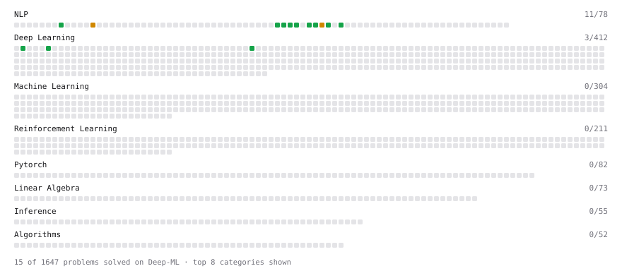

# Deep-ML

My machine learning practice from [Deep-ML](https://www.deep-ml.com). Every solution here was written by hand.

**27** solved · 19 problems · 1 labs · 7 math

[**Browse the interactive portfolio**](https://goldmx3-png.github.io/deep-ml/) to replay this filling in over time.

## Problems

| | Difficulty | Solved | |
| --- | --- | --- | --- |
| [Add Positional Embeddings to Token Embeddings](https://www.deep-ml.com/problems/946) | easy | 2026-10-29 | [solution](problems/0946-add-positional-embeddings-to-token-embeddings) |
| [BPE Decode Token IDs to Text](https://www.deep-ml.com/problems/951) | easy | 2026-10-24 | [solution](problems/0951-bpe-decode-token-ids-to-text) |
| [Build Vocabulary from Token List](https://www.deep-ml.com/problems/941) | easy | 2026-10-19 | [solution](problems/0941-build-vocabulary-from-token-list) |
| [Calculate Perplexity for Language Models](https://www.deep-ml.com/problems/320) | easy | 2026-10-18 | [solution](problems/0320-calculate-perplexity-for-language-models) |
| [Calculate Vocabulary Size from Token List](https://www.deep-ml.com/problems/953) | easy | 2026-10-24 | [solution](problems/0953-calculate-vocabulary-size-from-token-list) |
| [Compute Multi-class Cross-Entropy Loss](https://www.deep-ml.com/problems/134) | easy | 2026-10-17 | [solution](problems/0134-compute-multi-class-cross-entropy-loss) |
| [Construct Next-Token Prediction Targets](https://www.deep-ml.com/problems/954) | easy | 2026-10-30 | [solution](problems/0954-construct-next-token-prediction-targets) |
| [Embedding Layer as One-Hot Matrix Multiplication](https://www.deep-ml.com/problems/947) | easy | 2026-10-29 | [solution](problems/0947-embedding-layer-as-one-hot-matrix-multiplication) |
| [Find Most Frequent Token Pair for BPE](https://www.deep-ml.com/problems/948) | easy | 2026-10-24 | [solution](problems/0948-find-most-frequent-token-pair-for-bpe) |
| [Implementation of Log Softmax Function](https://www.deep-ml.com/problems/39) | easy | 2026-10-17 | [solution](problems/0039-implementation-of-log-softmax-function) |
| [Regex-Based Text Tokenizer](https://www.deep-ml.com/problems/940) | easy | 2026-10-18 | [solution](problems/0940-regex-based-text-tokenizer) |
| [Replace Token Pair in BPE Sequences](https://www.deep-ml.com/problems/949) | easy | 2026-10-24 | [solution](problems/0949-replace-token-pair-in-bpe-sequences) |
| [Simple Word Tokenizer Encode and Decode](https://www.deep-ml.com/problems/942) | easy | 2026-10-19 | [solution](problems/0942-simple-word-tokenizer-encode-and-decode) |
| [Softmax Activation Function Implementation ](https://www.deep-ml.com/problems/23) | easy | 2026-10-17 | [solution](problems/0023-softmax-activation-function-implementation) |
| [Token Embedding Lookup Table](https://www.deep-ml.com/problems/945) | easy | 2026-10-28 | [solution](problems/0945-token-embedding-lookup-table) |
| [Tokenizer with Unknown and End-of-Text Tokens](https://www.deep-ml.com/problems/943) | easy | 2026-10-24 | [solution](problems/0943-tokenizer-with-unknown-and-end-of-text-tokens) |
| [BPE Encode Text Using Merge Table](https://www.deep-ml.com/problems/950) | medium | 2026-10-24 | [solution](problems/0950-bpe-encode-text-using-merge-table) |
| [Byte Pair Encoding (BPE) Tokenizer](https://www.deep-ml.com/problems/380) | medium | 2026-10-24 | [solution](problems/0380-byte-pair-encoding-bpe-tokenizer) |
| [Entropy & Cross-Entropy](https://www.deep-ml.com/problems/205) | medium | 2026-10-17 | [solution](problems/0205-entropy-cross-entropy) |

## Labs

| | Difficulty | Solved | |
| --- | --- | --- | --- |
| [Build a Tokenizer for Language Modeling](https://www.deep-ml.com/labs/19) | medium | 2026-10-25 | [solution](labs/0019-build-a-tokenizer-for-language-modeling) |

## Math

| | Difficulty | Solved | |
| --- | --- | --- | --- |
| [Derivatives and Gradients](https://www.deep-ml.com/math-problems/1) | easy | 2026-10-18 | [solution](math/0001-derivatives-and-gradients) |
| [Gradient Descent Updates](https://www.deep-ml.com/math-problems/5) | easy | 2026-10-18 | [solution](math/0005-gradient-descent-updates) |
| [Matrix Basics](https://www.deep-ml.com/math-problems/9) | easy | 2026-10-11 | [solution](math/0009-matrix-basics) |
| [Vector Operations](https://www.deep-ml.com/math-problems/7) | easy | 2026-10-11 | [solution](math/0007-vector-operations) |
| [Information Theory: Entropy](https://www.deep-ml.com/math-problems/24) | medium | 2026-10-12 | [solution](math/0024-information-theory-entropy) |
| [Log-Likelihood Gradients](https://www.deep-ml.com/math-problems/38) | medium | 2026-10-17 | [solution](math/0038-log-likelihood-gradients) |
| [Softmax and Cross-Entropy](https://www.deep-ml.com/math-problems/32) | medium | 2026-10-12 | [solution](math/0032-softmax-and-cross-entropy) |

---

_This file is regenerated by Deep-ML on every push._
