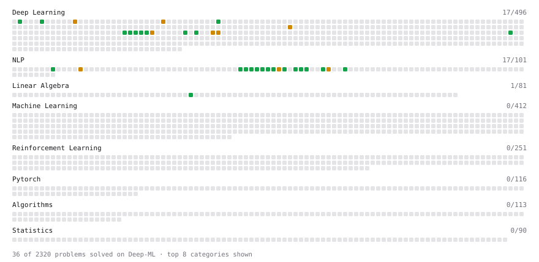

# Deep-ML

My machine learning practice from [Deep-ML](https://www.deep-ml.com). Every solution here was written by hand.

**57** solved · 42 problems · 2 labs · 13 math

[**Browse the interactive portfolio**](https://goldmx3-png.github.io/deep-ml/) to replay this filling in over time.

## Problems

| | Difficulty | Solved | |
| --- | --- | --- | --- |
| [Add Positional Embeddings to Token Embeddings](https://www.deep-ml.com/problems/946) | easy | 2026-10-29 | [solution](problems/0946-add-positional-embeddings-to-token-embeddings) |
| [Apply Dropout to Attention Weights](https://www.deep-ml.com/problems/956) | easy | 2026-11-11 | [solution](problems/0956-apply-dropout-to-attention-weights) |
| [BPE Decode Token IDs to Text](https://www.deep-ml.com/problems/951) | easy | 2026-10-24 | [solution](problems/0951-bpe-decode-token-ids-to-text) |
| [Build Bigram Count Matrix from Words](https://www.deep-ml.com/problems/983) | easy | 2026-11-03 | [solution](problems/0983-build-bigram-count-matrix-from-words) |
| [Build Vocabulary from Token List](https://www.deep-ml.com/problems/941) | easy | 2026-10-19 | [solution](problems/0941-build-vocabulary-from-token-list) |
| [Calculate Cosine Similarity Between Vectors](https://www.deep-ml.com/problems/76) | easy | 2026-11-18 | [solution](problems/0076-calculate-cosine-similarity-between-vectors) |
| [Calculate Perplexity for Language Models](https://www.deep-ml.com/problems/320) | easy | 2026-10-18 | [solution](problems/0320-calculate-perplexity-for-language-models) |
| [Calculate Vocabulary Size from Token List](https://www.deep-ml.com/problems/953) | easy | 2026-10-24 | [solution](problems/0953-calculate-vocabulary-size-from-token-list) |
| [Compute Multi-class Cross-Entropy Loss](https://www.deep-ml.com/problems/134) | easy | 2026-10-17 | [solution](problems/0134-compute-multi-class-cross-entropy-loss) |
| [Construct Causal Attention Mask via tril and triu Methods](https://www.deep-ml.com/problems/965) | easy | 2026-11-14 | [solution](problems/0965-construct-causal-attention-mask-via-tril-and-triu-methods) |
| [Construct Next-Token Prediction Targets](https://www.deep-ml.com/problems/954) | easy | 2026-10-30 | [solution](problems/0954-construct-next-token-prediction-targets) |
| [Dot Product Calculator](https://www.deep-ml.com/problems/83) | easy | 2026-11-17 | [solution](problems/0083-dot-product-calculator) |
| [Embedding Layer as One-Hot Matrix Multiplication](https://www.deep-ml.com/problems/947) | easy | 2026-10-29 | [solution](problems/0947-embedding-layer-as-one-hot-matrix-multiplication) |
| [Find Most Frequent Token Pair for BPE](https://www.deep-ml.com/problems/948) | easy | 2026-10-24 | [solution](problems/0948-find-most-frequent-token-pair-for-bpe) |
| [Generate Input-Target Batches for Language Model Training](https://www.deep-ml.com/problems/1080) | easy | 2026-10-30 | [solution](problems/1080-generate-input-target-batches-for-language-model-training) |
| [Implementation of Log Softmax Function](https://www.deep-ml.com/problems/39) | easy | 2026-10-17 | [solution](problems/0039-implementation-of-log-softmax-function) |
| [Laplace Smoothing for Bigram Probabilities](https://www.deep-ml.com/problems/987) | easy | 2026-11-03 | [solution](problems/0987-laplace-smoothing-for-bigram-probabilities) |
| [Matrix-Vector Dot Product](https://www.deep-ml.com/problems/1) | easy | 2026-11-18 | [solution](problems/0001-matrix-vector-dot-product) |
| [Pad and Truncate Tokenized Sequences](https://www.deep-ml.com/problems/1059) | easy | 2026-11-02 | [solution](problems/1059-pad-and-truncate-tokenized-sequences) |
| [Regex-Based Text Tokenizer](https://www.deep-ml.com/problems/940) | easy | 2026-10-18 | [solution](problems/0940-regex-based-text-tokenizer) |
| [Replace Token Pair in BPE Sequences](https://www.deep-ml.com/problems/949) | easy | 2026-10-24 | [solution](problems/0949-replace-token-pair-in-bpe-sequences) |
| [Scalar Multiplication of a Matrix](https://www.deep-ml.com/problems/5) | easy | 2026-11-18 | [solution](problems/0005-scalar-multiplication-of-a-matrix) |
| [Scale Attention Scores by sqrt(d_k)](https://www.deep-ml.com/problems/963) | easy | 2026-11-11 | [solution](problems/0963-scale-attention-scores-by-sqrt-d-k) |
| [Simple Self-Attention Without Trainable Weights](https://www.deep-ml.com/problems/955) | easy | 2026-11-10 | [solution](problems/0955-simple-self-attention-without-trainable-weights) |
| [Simple Word Tokenizer Encode and Decode](https://www.deep-ml.com/problems/942) | easy | 2026-10-19 | [solution](problems/0942-simple-word-tokenizer-encode-and-decode) |
| [Sliding Window Text Dataset Generator](https://www.deep-ml.com/problems/944) | easy | 2026-10-31 | [solution](problems/0944-sliding-window-text-dataset-generator) |
| [Softmax Activation Function Implementation ](https://www.deep-ml.com/problems/23) | easy | 2026-10-17 | [solution](problems/0023-softmax-activation-function-implementation) |
| [Token Embedding Lookup Table](https://www.deep-ml.com/problems/945) | easy | 2026-10-28 | [solution](problems/0945-token-embedding-lookup-table) |
| [Tokenizer with Unknown and End-of-Text Tokens](https://www.deep-ml.com/problems/943) | easy | 2026-10-24 | [solution](problems/0943-tokenizer-with-unknown-and-end-of-text-tokens) |
| [Transpose of a Matrix](https://www.deep-ml.com/problems/2) | easy | 2026-11-18 | [solution](problems/0002-transpose-of-a-matrix) |
| [Vector Element-wise Sum](https://www.deep-ml.com/problems/121) | easy | 2026-11-17 | [solution](problems/0121-vector-element-wise-sum) |
| [Vector Norms (L1/L2/L-inf) and the Frobenius Norm](https://www.deep-ml.com/problems/328) | easy | 2026-11-17 | [solution](problems/0328-vector-norms-l1-l2-l-inf-and-the-frobenius-norm) |
| [BPE Encode Text Using Merge Table](https://www.deep-ml.com/problems/950) | medium | 2026-10-24 | [solution](problems/0950-bpe-encode-text-using-merge-table) |
| [Build Scaled Dot-Product Attention](https://www.deep-ml.com/problems/490) | medium | 2026-11-12 | [solution](problems/0490-build-scaled-dot-product-attention) |
| [Byte Pair Encoding (BPE) Tokenizer](https://www.deep-ml.com/problems/380) | medium | 2026-10-24 | [solution](problems/0380-byte-pair-encoding-bpe-tokenizer) |
| [Entropy & Cross-Entropy](https://www.deep-ml.com/problems/205) | medium | 2026-10-17 | [solution](problems/0205-entropy-cross-entropy) |
| [Implement Batched Causal Self-Attention](https://www.deep-ml.com/problems/957) | medium | 2026-11-17 | [solution](problems/0957-implement-batched-causal-self-attention) |
| [Implement Masked Self-Attention](https://www.deep-ml.com/problems/107) | medium | 2026-11-16 | [solution](problems/0107-implement-masked-self-attention) |
| [Implement Self-Attention Mechanism](https://www.deep-ml.com/problems/53) | medium | 2026-11-14 | [solution](problems/0053-implement-self-attention-mechanism) |
| [MLP Character-Level Language Model Forward Pass](https://www.deep-ml.com/problems/989) | medium | 2026-11-05 | [solution](problems/0989-mlp-character-level-language-model-forward-pass) |
| [Sample from MLP Character Language Model](https://www.deep-ml.com/problems/991) | medium | 2026-11-06 | [solution](problems/0991-sample-from-mlp-character-language-model) |
| [Train Bigram Language Model as a Neural Network](https://www.deep-ml.com/problems/988) | medium | 2026-11-04 | [solution](problems/0988-train-bigram-language-model-as-a-neural-network) |

## Labs

| | Difficulty | Solved | |
| --- | --- | --- | --- |
| [Build a Tokenizer for Language Modeling](https://www.deep-ml.com/labs/19) | medium | 2026-10-25 | [solution](labs/0019-build-a-tokenizer-for-language-modeling) |
| [Design Your Own Attention Mechanism](https://www.deep-ml.com/labs/10) | medium | 2026-11-18 | [solution](labs/0010-design-your-own-attention-mechanism) |

## Math

| | Difficulty | Solved | |
| --- | --- | --- | --- |
| [Derivatives and Gradients](https://www.deep-ml.com/math-problems/1) | easy | 2026-10-18 | [solution](math/0001-derivatives-and-gradients) |
| [Gradient Descent Updates](https://www.deep-ml.com/math-problems/5) | easy | 2026-10-18 | [solution](math/0005-gradient-descent-updates) |
| [Matrix Basics](https://www.deep-ml.com/math-problems/9) | easy | 2026-10-11 | [solution](math/0009-matrix-basics) |
| [Vector Operations](https://www.deep-ml.com/math-problems/7) | easy | 2026-10-11 | [solution](math/0007-vector-operations) |
| [Backpropagation and the Chain Rule](https://www.deep-ml.com/math-problems/4) | medium | 2026-11-10 | [solution](math/0004-backpropagation-and-the-chain-rule) |
| [Determinants and Trace](https://www.deep-ml.com/math-problems/11) | medium | 2026-11-20 | [solution](math/0011-determinants-and-trace) |
| [Information Theory: Entropy](https://www.deep-ml.com/math-problems/24) | medium | 2026-10-12 | [solution](math/0024-information-theory-entropy) |
| [Log-Likelihood Gradients](https://www.deep-ml.com/math-problems/38) | medium | 2026-10-17 | [solution](math/0038-log-likelihood-gradients) |
| [Matrix Calculus Identities](https://www.deep-ml.com/math-problems/35) | medium | 2026-11-07 | [solution](math/0035-matrix-calculus-identities) |
| [Matrix Multiplication](https://www.deep-ml.com/math-problems/10) | medium | 2026-11-17 | [solution](math/0010-matrix-multiplication) |
| [Neural Network Derivatives](https://www.deep-ml.com/math-problems/3) | medium | 2026-11-10 | [solution](math/0003-neural-network-derivatives) |
| [Softmax and Cross-Entropy](https://www.deep-ml.com/math-problems/32) | medium | 2026-10-12 | [solution](math/0032-softmax-and-cross-entropy) |
| [Vector Norms and Linear Independence](https://www.deep-ml.com/math-problems/8) | medium | 2026-11-17 | [solution](math/0008-vector-norms-and-linear-independence) |

---

_This file is regenerated by Deep-ML on every push._
